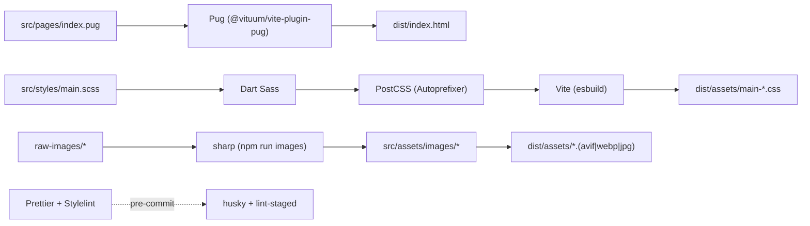

# Keepsake — Landing Page

Live Demo [https://udalovivanw.github.io/landing-keepsake-vite/](https://udalovivanw.github.io/landing-keepsake-vite/)
---

## Вимоги до середовища та команди запуску

- **Node.js:** версія `20.x` (LTS) або новіша
- **npm:** версія `10.x` або новіша

## Основні npm-скрипти

| Команда           | Призначення                                                                            |
| :---------------- | :------------------------------------------------------------------------------------- |
| `npm install`     | Встановлення залежностей із `package-lock.json` та ініціалізація Git-хуків (`prepare`) |
| `npm run dev`     | Запуск dev-сервера Vite (`http://localhost:5173/`) із миттєвим HMR                     |
| `npm run build`   | Продакшн-збірка у `dist/` (компіляція Pug/SCSS, PostCSS, мініфікація)                  |
| `npm run preview` | Локальний перегляд зібраного проєкту (`http://localhost:4173/landing-keepsake-vite/`)  |
| `npm run images`  | Пакетна конвертація оригіналів у AVIF, WebP та JPEG (`400w` і `800w`) через `sharp`    |
| `npm run format`  | Автоматичне форматування `.pug`, `.scss`, `.js`, `.json`, `.md` через Prettier         |
| `npm run lint`    | Перевірка якості SCSS (`stylelint`) та стилю форматування (`prettier --check`)         |

---

Fast test after clone : npm run format && npm run lint && npm run build && npm run preview
---

## Конвеєр збірки проєкту



## Структура проєкту

```text
landing-keepsake-vite/
├── .github/workflows/
│   └── deploy.yml
├── .husky/
│   └── pre-commit             # Git-hook
├── scripts/
│   └── optimize-images.js     # Скрипт конвертації зображень на базі sharp
├── src/
│   ├── assets/images/         # Оптимізовані зображення
│   ├── components/
│   │   ├── sections/          # hero, works, cta, services, stats, clients, journal
│   │   ├── header.pug
│   │   └── footer.pug
│   ├── data/                  # Інформація для заповнення сайту інформацію
│   ├── includes/
│   │   └── sprite.svg         # SVG
│   ├── layouts/
│   │   └── main.pug           # HTML-макет
│   ├── mixins/                # Pug-міксини (+btn, +icon, +picture, +work-card)
│   ├── pages/
│   │   └── index.pug          # Головна сторінка, що успадковує базовий макет
│   └── styles/
│       ├── abstracts/         # Дизайн-токени ($colors, $fonts), функція rem(), міксини mq()
│       ├── base/              # CSS custom properties (:root) та reset
│       ├── layout/            # containers, section, header, footer
│       ├── components/        # Стилі для кожного бдлке
│       └── main.scss          # Точка входу
├── .browserslistrc            # Autoprefixer browser list
├── .prettierrc                # Prettier configuration
├── .stylelintrc.json          # Правила Stylelint під БЕМ
├── postcss.config.js          # Autoprefixer config
└── vite.config.js             # Vite configuration
```

---

## Архітектурні рішення

### 1. Шаблонізація на Pug

- **Каркас і компоненти:** базовий макет у `src/layouts/main.pug` (`extends`, `block`), повторні блоки (шапка, підвал, секції, SVG-спрайт) підключені через `include`.
- **Дані окремо від розмітки:** контент зберігається у `src/data/*.pug` і виводиться циклами `each`.
- **Міксини:** створено перевикористовувані компоненти (`+btn`, `+icon`, `+picture`, `+work-card`, `+section`).

### 2. Модульний SCSS (патерн 7-1)

- **Dart Sass:** підключення через `@use` та `@forward` замість `@import`.
- **Змінні:** кольори з SASS-мапи `$colors` циклом `@each` генеруються у CSS-змінні `--color-*` в `:root`.
- **БЕМ і адаптивність:** методологія БЕМ (вкладеність до 3 рівнів) та _mobile-first_ через міксин `@include mq()`.

### 3. Залежності (npm)

- Усі інструменти збірки та лінтингу винесені в `devDependencies`.
- Версії зафіксовані в `package-lock.json` (`npm ci`), а `node_modules/` та `dist/` додані до `.gitignore`.

## Використані інструменти

| **Інструмент**                                   | **Призначення**                                                          |
| ------------------------------------------------ | ------------------------------------------------------------------------ |
| **Vite**                                         | Швидкий збирач проєкту, dev-сервер та мініфікація CSS/HTML через esbuild |
| **Vituum + `@vituum/vite-plugin-pug`**           | Інтеграція шаблонізатора Pug у конвеєр збірки Vite                       |
| **Dart Sass (`sass`)**                           | Компіляція модульного SCSS у CSS                                         |
| **PostCSS + Autoprefixer**                       | Автоматичне додавання вендорних префіксів згідно з Browserslist          |
| **sharp**                                        | Пакетна конвертація та ресайз растрових зображень у AVIF, WebP та JPEG   |
| **Prettier + `@prettier/plugin-pug`**            | Єдиний стиль форматування для Pug, SCSS, JS та конфігів                  |
| **Stylelint + `stylelint-config-standard-scss`** | Статичний аналіз SCSS, перевірка БЕМ-селекторів та глибини вкладеності   |
| **Husky + lint-staged**                          | Запуск лінтерів на staged-файлах перед кожним комітом (`pre-commit`)     |

## Цільові браузери (Browserslist)

Plaintext

```
last 2 Chrome versions
last 2 Firefox versions
last 2 Edge versions
last 2 Safari versions
last 2 iOS versions
```

## Результати оптимізації

| **Ресурс**                                          | **До оптимізації**           | **Після оптимізації**            | **Економія / Примітка**                                        |
| --------------------------------------------------- | ---------------------------- | -------------------------------- | -------------------------------------------------------------- |
| **Зображення картки**                               | ~2.5 KB (вихідний JPEG/WebP) | 9.77 kB (AVIF) / 10.55 kB (WebP) | Зменшення ваги на 60% без втрати візуальної якості             |
| **Зображення картки (`400w`, мобільні)**            | ~2.5 KB                      | ~4.56 kB (AVIF) / 5.05 kB (WebP) | Завантаження меншого розміру через `srcset` + `loading="lazy"` |
| **CSS-бандл (main.scss → dist/assets/main-\*.css)** | ~31.0 KB                     | 24.98 kB (gzip: 4.65 kB)         | Автоматична мініфікація esbuild у Vite + префікси Autoprefixer |
